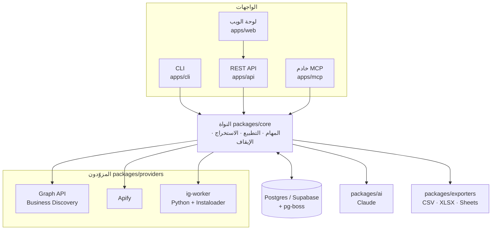

# مشروع Scrapers — الخطة المتكاملة

> النسخة 1.1 · 2026-11-21 · حُدّثت بإجابات صاحب المشروع (القسم 17)
> هذه الخطة تدمج ثلاثة مصادر: خطة البناء المرفوعة، وملاحظات جمع المتطلبات (`docs/PROJECT_NOTES.md`)، ومراجعة جدوى لكل مصدر بيانات. المراجع المفتوحة المصدر محفوظة في `docs/references.md`.

---

## 0. الملخص التنفيذي

**Scrapers** منصة لجمع العملاء المحتملين من إنستقرام. تلصق رابط حساب منافس أو منشور أو هاشتاق، فتجمع المنصة الحسابات المرتبطة به، وتستخرج منها البيانات المنشورة علناً، ثم تصنّفها بالذكاء الاصطناعي وتصدّرها إلى Google Sheets أو إلى ملف.

البناء قائم على نواة واحدة (core) فيها كل المنطق، وفوقها أربع واجهات رقيقة:

| الواجهة | التقنية | الاستخدام |
|---|---|---|
| CLI ولوحة ويب | أمر `scrapers` و Next.js | تشغيل يدوي |
| REST API | Hono مع مفاتيح API | الربط مع n8n أو أي نظام آخر |
| MCP | خادم MCP يعمل محلياً (stdio) أو عن بُعد (Streamable HTTP) | Claude وأي عميل MCP |
| AI | طبقة تصنيف وتنقيط | فرز العملاء حسب جودتهم |

### القرارات المحسومة في هذه الخطة

1. **نبدأ مجاناً وبدون أي حساب إنستقرام.** الاكتشاف يكون برفع قائمة معرّفات (CSV) وهو مجاني دائماً، أو عبر Apify ضمن رصيده المجاني الشهري فقط. جلب تفاصيل الحسابات يكون عبر Instaloader المجاني. مزوّد Graph API مؤجّل حتى يتوفر حساب تجاري. السبب مشروح في القسم 4: **اكتشاف المتفاعلين بدون تسجيل دخول غير ممكن عملياً بالمكتبات المفتوحة**.
2. **Claude هو لوحة التحكم الأولى.** خادم MCP يأتي في المرحلة الثانية، قبل لوحة الويب.
3. **البيانات العامة فقط.** لا نطلب كلمة مرور إنستقرام، ولا نتجاوز CAPTCHA. وسائل التواصل تُحفظ للحسابات التجارية وحسابات المؤثرين فقط.
4. **قاعدة بيانات واحدة:** Postgres على Supabase بالخطة المجانية. الطابور (pg-boss) يعمل داخلها أيضاً، فلا نحتاج Redis.
5. **أرقام من جميع الدول:** لا توجد دولة افتراضية للمشروع. الأرقام بالصيغة الدولية تُقبل مباشرة، والأرقام المحلية نستنتج دولتها من البايو، وإلا نحفظها خاماً كرقم "غير مؤكد" (القسم 7).
6. **مستخدم واحد:** اللوحة لصاحب المشروع وحده، فلا نبني نظام فرق أو صلاحيات متعددة.

---

## 1. الأهداف والنطاق

### داخل النطاق (الإصدار 1)
- المصادر: حساب منافس، أو منشور، أو هاشتاق، أو قائمة معرّفات يرفعها المستخدم (CSV).
- استخراج: المعرّف، والاسم، والبايو، وعدد المتابعين، والتصنيف، والرابط الخارجي، والإيميل والهاتف إن كانا معلنين.
- إزالة التكرار، وقائمة إيقاف (suppression)، وحذف تلقائي بعد مدة.
- تصنيف وتنقيط بالذكاء الاصطناعي حسب معايير يكتبها المستخدم بنص حر.
- التصدير إلى CSV أو XLSX أو شيت Google جديد أو شيت موجود.
- الواجهات الأربع.

### خارج النطاق (الإصدار 1)
- إرسال الرسائل أو الإيميلات الجماعية، أي أتمتة التواصل.
- تسجيل الدخول بحسابات إنستقرام، أو تدوير حسابات وهمية.
- منصات أخرى. المعمارية تسمح بإضافتها لاحقاً، مثل TikTok، بكتابة مزوّد جديد فقط.
- نظام مستخدمين متعدد أو اشتراكات (SaaS). المنصة لمستخدم واحد.

### مؤشرات النجاح
| المؤشر | الهدف |
|---|---|
| زمن مهمة من 500 حساب | أقل من 15 دقيقة |
| نسبة الحسابات التجارية التي نجد لها وسيلة تواصل | 40% أو أكثر |
| دقة التصنيف بالـ AI (عيّنة يدوية من 100 حساب) | 85% أو أكثر |
| مهام تفشل بسبب الحظر | أقل من 5% بفضل التحويل التلقائي بين المزوّدين |

---

## 2. الامتثال (ملخص ملزم للتنفيذ)

> لست محامياً. راجع محامياً قبل أي استخدام تجاري.

| القاعدة | كيف تُطبَّق في الكود |
|---|---|
| البيانات العامة فقط | لا يوجد في أي مزوّد حقل لكلمة مرور إنستقرام أو كوكيز جلسة |
| أقل قدر من البيانات | الحسابات الشخصية تُحفظ بمعرّفها وتصنيفها فقط، و `email` و `phone` لها تبقى `NULL` بقيد في قاعدة البيانات |
| مصدر مسجّل لكل عميل | العمودان `job_id` و `contact_source` إلزاميان |
| حذف تلقائي | `expires_at = fetched_at + retention_days`، ومهمة pg-boss يومية تحذف المنتهي |
| حق الحذف | الأداة `suppress` تحذف السجل، وتحفظ hash للمعرّف حتى لا يُجمع مرة أخرى |
| لا تجاوز للحمايات | استجابة 429 أو صفحة تسجيل دخول توقف المهمة وتنقلها لمزوّد آخر، ولا نعيد المحاولة بإلحاح |
| الترويج المالي | تنبيه ظاهر في اللوحة وفي وصف خادم MCP بأن التواصل غير المطلوب بشأن منتجات مالية قد يخالف قواعد الجهات الرقابية وشروط الوسطاء |

---

## 3. المعمارية



### دورة حياة المهمة

```
start_job ─► jobs(status=queued) ─► pg-boss: "discover"
   │
   ▼
discover   : المزوّد يعيد قائمة معرّفات (المتفاعلون، المعلّقون، المنشورون بالهاشتاق)
   │         ─► pg-boss: "enrich" على دفعات من 50
   ▼
enrich     : getProfile لكل معرّف ─► profiles (upsert حسب ig_user_id)
   │
   ▼
extract    : استخراج وسيلة التواصل ─► leads (مع استبعاد من في suppression)
   │
   ▼
score?     : اختياري، تصنيف وتنقيط بالـ AI عبر Batches API
   │
   ▼
export?    : اختياري، شيت أو ملف ─► jobs(status=done, counts)
```

- **كل مرحلة مهمة مستقلة في pg-boss.** لكل مرحلة إعادة محاولة بانتظار تصاعدي (exponential backoff)، وسقف من 3 محاولات، ثم تنتقل المهمة إلى "dead letter".
- **التقدّم** يُحفظ في `jobs.counts`، مثلاً `{discovered, enriched, leads, failed}`، ويقرؤه `get_job` واللوحة.
- **الإلغاء:** `cancel_job` يضع `status=cancelled`، وكل عامل يتحقق منها قبل كل دفعة.

---

## 4. المزوّدون — مصفوفة القدرات الواقعية

هذا القسم يحسم السؤال الذي بقي مفتوحاً في الخطة السابقة: هل نبدأ بـ Instaloader أم بـ Apify؟

| القدرة | Graph API (Business Discovery) | Apify | Instaloader بدون تسجيل دخول |
|---|---|---|---|
| ملف عام لحساب تجاري | ✅ رسمي | ✅ | ✅ بمعدل منخفض |
| ملف عام لحساب شخصي | ❌ | ✅ | ✅ بمعدل منخفض |
| إيميل أو هاتف من زر التواصل | ❌ غير متاح في هذه الواجهة | ✅ في الـ Actors المخصصة للعملاء | ⚠️ أحياناً، من بيانات الملف الخام |
| منشورات المنافس | ✅ | ✅ | ✅ |
| **المعلّقون على منشور** | ❌ | ✅ | ❌ يتطلب تسجيل دخول |
| **المنشورون في هاشتاق** | ⚠️ يعيد المنشورات بدون أصحابها | ✅ | ❌ يتطلب تسجيل دخول |
| التكلفة | مجاني | مدفوع بحسب عدد النتائج | مجاني |
| المتطلبات | حساب إنستقرام تجاري + تطبيق Meta | توكن API | لا شيء |
| خطر الحظر | لا يوجد | يتحمّله المزوّد | متوسط، والمتأثر هو IP العامل |

### الاستنتاج والقرار
- **الاكتشاف (discover)** يكون عبر **قائمة معرّفات يرفعها المستخدم** (مجاني)، أو عبر Apify ضمن الرصيد المجاني الشهري. عند نفاد الرصيد تتوقف المهمة وتُبلغ المستخدم، ولا يُخصم أي مبلغ.
- **الإثراء (enrich)** يجرّب Instaloader أولاً، ثم Apify ضمن الرصيد المجاني.
- **Graph API مؤجّل.** يتطلب حساباً تجارياً أو حساب صانع محتوى (Creator)، وتحويل أي حساب عادي إلى Creator مجاني من إعدادات إنستقرام. عندها نفعّله مزوّداً أول للحسابات التجارية دون تغيير في الكود، فقط بإضافة المتغيرات.
- **لا نسجّل الدخول بحساب عادي.** هذا يخالف شروط ميتا ويعرّض الحساب للحظر الدائم، وهو قرار ثابت في قسم الامتثال.
- **الموجّه (router)** في النواة يختار المزوّد حسب ثلاثة أمور: هل المزوّد يدعم هذه القدرة، وهل بقي له رصيد من الطلبات في الدقيقة، وما تكلفته.

### الواجهة الموحّدة (TypeScript)

```ts
// packages/providers/src/types.ts
export type Capability =
  | "profile" | "business_contact" | "post_commenters"
  | "hashtag_posters" | "account_posts";

export interface Provider {
  id: "graph" | "apify" | "worker";
  capabilities: ReadonlySet<Capability>;
  ratePerMinute: number;
  costPer1k?: number;                       // بالدولار، لعرض التكلفة قبل التشغيل
  getProfile(username: string): Promise<RawProfile>;
  listEngagers(src: Source, limit: number): AsyncIterable<string>; // معرّفات
}
```

إذا أعاد مزوّد الخطأ `RateLimitedError` أو `BlockedError`، ينقل الموجّه الدفعة إلى المزوّد التالي، ويوقف المزوّد الأول مؤقتاً (cooldown).

---

## 5. حزمة التقنيات

> نتحقق من الإصدارات بأمر `pnpm outdated` و `uv lock --upgrade` عند بدء كل مرحلة.

| الطبقة | التقنية |
|---|---|
| المستودع | pnpm workspaces + Turborepo |
| التشغيل | Node.js 24 LTS، مع الترقية إلى 26 LTS بعد التأكد من توافق المكتبات. TypeScript 5.x في الوضع strict |
| التحقق من المدخلات | Zod v4، ومخطط واحد مشترك بين الـ API وأدوات MCP والـ CLI |
| الـ API | Hono + `@hono/zod-openapi`، ويولّد توثيق OpenAPI تلقائياً |
| MCP | MCP TypeScript SDK v2 (`@modelcontextprotocol/server`)، مواصفات 2026-07-28 |
| الـ CLI | `citty` أو `commander`، مع `@clack/prompts` للتفاعل |
| اللوحة | Next.js 16 (App Router) + Tailwind v4 + shadcn/ui، بواجهة RTL عربية |
| العامل | Python 3.14 + uv + FastAPI + httpx + Instaloader 4.15.x |
| قاعدة البيانات | Supabase Postgres + Drizzle ORM و drizzle-kit |
| الطابور | pg-boss |
| استخراج الهاتف | libphonenumber-js |
| التصدير | ExcelJS، ومولّد CSV، و googleapis (Sheets v4 و Drive v3) |
| الذكاء الاصطناعي | `@anthropic-ai/sdk`: Haiku 5.5 للتصنيف عبر Batches API، و Sonnet 5.5 للتقارير |
| الجودة | Biome، و Vitest، و pytest، و Playwright للوحة |
| السجلات والمراقبة | pino (سجلات JSON)، و OpenTelemetry، و Sentry |
| النشر | Docker على Railway |

---

## 6. نموذج البيانات

```sql
create table projects (
  id              uuid primary key default gen_random_uuid(),
  name            text not null,
  owner           text not null,
  sheet_id        text,                       -- شيت موجود (اختياري)
  ai_criteria     text,                       -- معايير التنقيط بنص حر
  retention_days  int  not null default 90,
  created_at      timestamptz not null default now()
);

create type source_type as enum ('profile','post','hashtag','upload');
create type job_status  as enum ('queued','running','done','failed','cancelled');

create table jobs (
  id           uuid primary key default gen_random_uuid(),
  project_id   uuid not null references projects on delete cascade,
  source_type  source_type not null,
  source_url   text not null,
  "limit"      int  not null check ("limit" between 1 and 5000),
  provider     text,                          -- المزوّد الذي استُخدم فعلاً
  status       job_status not null default 'queued',
  counts       jsonb not null default '{}',
  cost_usd     numeric(10,4) default 0,
  error        text,
  started_at   timestamptz,
  finished_at  timestamptz,
  created_at   timestamptz not null default now()
);

create table profiles (
  ig_user_id    text primary key,
  username      text not null unique,
  full_name     text,
  bio           text,
  followers     int,
  following     int,
  posts         int,
  is_business   boolean not null default false,
  is_verified   boolean not null default false,
  category      text,
  external_url  text,
  fetched_at    timestamptz not null default now(),
  fetched_by    text not null                -- graph | apify | worker
);

create type contact_source as enum ('business_button','bio','link');

create table leads (
  id              uuid primary key default gen_random_uuid(),
  project_id      uuid not null references projects on delete cascade,
  profile_id      text not null references profiles on delete cascade,
  job_id          uuid not null references jobs on delete cascade,
  email           text,
  phone_e164      text,                       -- رقم مؤكد بصيغة دولية
  phone_raw       text,                       -- الرقم كما ورد، إن لم نتأكد من دولته
  phone_country   char(2),                    -- رمز الدولة ISO، مثل SA و IQ و EG
  contact_source  contact_source,
  ai_score        smallint check (ai_score between 0 and 100),
  ai_tags         text[],
  ai_reason       text,
  expires_at      timestamptz not null,
  created_at      timestamptz not null default now(),
  unique (project_id, profile_id)
);

create table suppression (
  value_hash  text primary key,               -- sha256(normalize(value) + pepper)
  kind        text not null check (kind in ('username','email','phone')),
  reason      text,
  created_at  timestamptz not null default now()
);

create table api_keys (
  id          uuid primary key default gen_random_uuid(),
  name        text not null,
  key_hash    text not null unique,
  scopes      text[] not null default '{read}',
  last_used   timestamptz,
  created_at  timestamptz not null default now()
);

create index on leads (project_id, ai_score desc);
create index on leads (expires_at);
create index on jobs  (project_id, created_at desc);
```

**قاعدة الحسابات الشخصية:** قيد الحسابات الشخصية يُفرض في النواة قبل الكتابة. لا نستطيع فرضه كقيد CHECK في قاعدة البيانات لأن `is_business` موجود في جدول آخر. ونغطيه باختبار وحدة إلزامي.

---

## 7. مسار استخراج وسيلة التواصل

```
RawProfile
  │
  ├─ 1. حساب تجاري وله زر تواصل؟ ─► email/phone، و contact_source = business_button
  │
  ├─ 2. حساب تجاري أو مؤثر (10k متابع أو أكثر، أو موثّق)؟
  │       نطبّع البايو: نحوّل الأرقام العربية الهندية (٠١٢) والفارسية (۰۱۲) إلى لاتينية،
  │       ونزيل الإيموجي الفاصل، ونحوّل "at" و "dot" إلى @ و .
  │       ─► regex للإيميل، و findPhoneNumbersInText (libphonenumber-js)
  │       تحديد دولة الرقم (جميع الدول، بلا دولة افتراضية):
  │         أ. الرقم يبدأ بـ + أو 00 ─► يُحلَّل مباشرة ─► phone_e164
  │         ب. رقم محلي ─► نستنتج الدولة من البايو: علم إيموجي، أو اسم دولة
  │            أو مدينة، أو رابط wa.me، أو نطاق الإيميل (.sa و .iq ...)،
  │            ثم نتأكد أن الرقم صالح لتلك الدولة ─► phone_e164
  │         ج. لم نتأكد ─► phone_raw فقط مع وسم "غير مؤكد"،
  │            وطبقة AI تقترح الدولة لاحقاً إن كانت مفعّلة
  │       contact_source = bio
  │
  ├─ 3. الرابط الخارجي من نوع linktree أو wa.me أو mailto؟
  │       نحلل الرابط نفسه فقط، ولا نزحف داخل المواقع
  │       ─► contact_source = link
  │
  ├─ 4. التحقق: صيغة الإيميل + سجل MX للنطاق (مع تخزين مؤقت)، وصلاحية الرقم
  │
  ├─ 5. نستبعد ما يطابق hash في suppression
  │
  └─ 6. حساب شخصي؟ ─► نحفظ lead بدون email و phone (للتصنيف فقط)
```

كل خطوة دالة نقية (pure function) في `packages/core/src/extract/`، ولها اختبارات مبنية على ملفات نماذج (fixtures) تحتوي بايوهات حقيقية الشكل بالعربية والإنجليزية.

---

## 8. الواجهات

### 8.1 الـ CLI

```bash
scrapers project create "وكلاء الخليج" --retention 90 --sheet <id>
scrapers job start https://instagram.com/competitor --type profile --limit 500 --project <id>
scrapers job start ./usernames.csv --type upload --project <id>
scrapers job status <job_id> --watch
scrapers leads list --project <id> --business --has-email --min-score 70
scrapers score <job_id> --criteria "وكيل محتمل في الخليج، يتحدث العربية"
scrapers export <job_id> --format xlsx|csv|sheet [--sheet <id>]
scrapers suppress --email a@b.com
scrapers worker                  # تشغيل عمّال pg-boss محلياً
```

### 8.2 الـ REST API (`/v1`)

| الطريقة | المسار | النطاق (scope) |
|---|---|---|
| POST | `/projects` | write |
| GET | `/projects/:id` | read |
| POST | `/jobs` | write |
| GET | `/jobs/:id` | read |
| POST | `/jobs/:id/cancel` | write |
| POST | `/jobs/:id/score` | write |
| POST | `/jobs/:id/export` | write |
| GET | `/leads?project=&business=&has_email=&min_score=&cursor=` | read |
| GET | `/profiles/:username` | read |
| POST | `/suppression` | write |
| GET | `/openapi.json` ، `/docs` | عام |

- المصادقة بترويسة `Authorization: Bearer sk_...`. المفتاح يُخزَّن hash فقط.
- حد للطلبات لكل مفتاح، وترويسة `Idempotency-Key` لطلبات POST على `/jobs`.
- إشعار webhook اختياري عند انتهاء المهمة، مفيد لـ n8n.

### 8.3 خادم MCP

**الأدوات (tools):** كل أداة تستخدم نفس مخطط Zod الذي يستخدمه الـ API.

| الأداة | المدخلات | المخرجات |
|---|---|---|
| `start_job` | source_url, source_type, limit (حتى 1000), project | job_id، والتكلفة التقديرية |
| `get_job` | job_id | الحالة، والأعداد، ونسبة التقدّم |
| `cancel_job` | job_id | الحالة |
| `list_leads` | project, filters, cursor | صفحة من 50 عميلاً |
| `get_profile` | username | ملف عام واحد مع مصدره |
| `score_leads` | job_id, criteria | عدد الحسابات التي نُقّطت |
| `export_leads` | job_id, format, sheet_id? | رابط الشيت أو مسار الملف |
| `suppress` | username / email / phone | تأكيد الحذف |

**الموارد (resources):**
- `leads://{project}/latest`
- `jobs://{id}/summary`
- `projects://list`

**القوالب الجاهزة (prompts):**
- `find_partners`: يجمع الحسابات ويصنّفها ويصدّر أفضلها، في سير عمل واحد جاهز.
- `audience_report`: تقرير عن جمهور منافس.

**طرق التشغيل:**
- `stdio`: يُضاف إلى Claude Desktop أو Claude Code بأمر `npx @scrapers/mcp`.
- `Streamable HTTP` على `/mcp`: موصّل مخصّص في claude.ai. بما أن المستخدم واحد، نبني OAuth بسيطاً بمستخدم واحد (الإيميل المسموح فقط)، وهذا في المرحلة الثالثة. قبلها نستخدم stdio محلياً.

**المهام الطويلة:** `start_job` تعود فوراً، ويتابع Claude التقدّم بـ `get_job`. نعتمد آلية المهام الطويلة في مواصفات MCP الجديدة إن كان الـ SDK يدعمها، وإلا نكتفي بالمتابعة الدورية.

### 8.4 لوحة الويب (المرحلة الثالثة)

| الصفحة | المحتوى |
|---|---|
| `/` | المشاريع وآخر المهام |
| `/jobs/new` | لصق الرابط، واختيار النوع والحد، وعرض التكلفة التقديرية قبل التشغيل |
| `/jobs/[id]` | التقدّم مباشرة (SSE)، والأعداد، والأخطاء |
| `/leads` | جدول بفلاتر وفرز حسب الدرجة، وتصدير، وإيقاف |
| `/settings` | مفاتيح API، وربط Google، ومعايير الـ AI، ومدة الاحتفاظ |

الدخول عبر Supabase Auth بحساب Google، ويُسمح لإيميل واحد فقط (`OWNER_EMAIL`). لا توجد صفحة تسجيل للآخرين.

---

## 9. التصدير

| المخرج | الآلية |
|---|---|
| شيت جديد | Service Account + Sheets API: ينشئ ملفاً باسم `Scrapers – {project} – {date}`، ويثبّت صف العناوين، ويشاركه مع إيميل المالك عبر Drive API |
| شيت موجود | `spreadsheets.values.append`، بعد قراءة عمود username لتجاهل المكرّر |
| CSV | UTF-8 مع BOM حتى تظهر العربية صحيحة في Excel |
| XLSX | ExcelJS مع اتجاه RTL، وتجميد صف العناوين، وتنسيق شرطي حسب الدرجة |
| عبر Claude | Claude يقرأ `list_leads` ويكتب في الشيت بموصّل Google Sheets المربوط عنده، دون Service Account |

**الأعمدة الثابتة:** username · full_name · category · followers · email · phone · contact_source · ai_score · ai_tags · ai_reason · source_url · fetched_at

لكتابة الشيت حد يقارب 60 طلب كتابة في الدقيقة، لذلك نرسل الصفوف على دفعات من 500 صف في الطلب الواحد.

---

## 10. طبقة الذكاء الاصطناعي

- **المدخل:** الملف العام بعد تطبيعه، دون إرسال الإيميل أو الهاتف إلى النموذج لأن التصنيف لا يحتاجهما.
- **المخرج:** JSON مطابق لمخطط Zod، وما لا يطابقه يُرفض ويُعاد مرة واحدة.

```ts
const LeadScore = z.object({
  segment: z.enum(["individual_trader","educator","finance_creator",
                   "potential_partner","business","irrelevant","bot_or_fake"]),
  language: z.string(),          // ar | en | ...
  country:  z.string().nullable(),
  score:    z.number().int().min(0).max(100),
  reason:   z.string().max(200),
});
```

- **الدفعات:** Message Batches API مع Haiku 5.5، وهو أرخص بنحو 50% من الطلبات العادية. نضع التعليمات والمعايير في بداية الطلب، ونستفيد من التخزين المؤقت للتعليمات (prompt caching).
- **التقرير:** Sonnet 5.5 يكتب ملخصاً بتوزيع الفئات واللغات وأبرز المؤثرين، ويُحفظ في `jobs.counts.report`.
- **في وضع MCP** لا نحتاج مفتاح Anthropic، فـ Claude نفسه يصنّف بعد قراءة النتائج.
- **التقييم:** مجموعة من 100 حساب مصنّفة يدوياً في `packages/ai/eval/`، ونشغّلها في CI عند تعديل التعليمات.

---

## 11. الأمن والإعدادات

```env
DATABASE_URL=                 # Supabase (pooler)
DIRECT_DATABASE_URL=          # للـ migrations
SUPPRESSION_PEPPER=           # سر لتجزئة قائمة الإيقاف
APIFY_TOKEN=
APIFY_MONTHLY_CAP_USD=0       # 0 = الرصيد المجاني فقط
OWNER_EMAIL=                  # المستخدم الوحيد المسموح له بالدخول
# لاحقاً عند توفر حساب تجاري:
# META_APP_ID= / META_APP_SECRET= / IG_BUSINESS_ACCOUNT_ID= / IG_GRAPH_TOKEN=
WORKER_URL=http://ig-worker:8000
WORKER_SHARED_SECRET=
GOOGLE_SERVICE_ACCOUNT_JSON=  # base64
ANTHROPIC_API_KEY=            # اختياري
SENTRY_DSN=
MAX_JOB_LIMIT=1000
DEFAULT_RETENTION_DAYS=90
```

- **الأسرار:** تُحفظ في متغيرات Railway فقط، ولا يوجد أي سر في المستودع. ملف `.env.example` يحتوي الأسماء بدون قيم.
- **العامل:** شبكة داخلية فقط، ولا يُعرض للإنترنت. كل طلب إليه يحمل `WORKER_SHARED_SECRET`.
- **Supabase:** تفعيل Row Level Security على كل الجداول، والوصول من الخادم بدور service.
- **التحقق:** كل مدخل يمر عبر Zod، ونقبل فقط الروابط التي تطابق `instagram.com/...`، فلا يُطلب أي رابط آخر من الخادم (حماية من SSRF).
- **السجلات:** لا نكتب الإيميلات أو الأرقام في السجلات (masking).

---

## 12. الجودة والاختبار و CI

| النوع | الأداة | التغطية |
|---|---|---|
| وحدة | Vitest | الاستخراج، والتطبيع، والموجّه، والإيقاف، وقاعدة الحسابات الشخصية |
| تكامل | Vitest + Postgres في Docker | دورة المهمة كاملة بمزوّد وهمي (mock provider) |
| العقود (contracts) | ملفات JSON مسجّلة من كل مزوّد | اكتشاف تغيّر بنية الاستجابة مبكراً |
| العامل | pytest + respx | Instaloader مع ردود محفوظة |
| MCP | MCP Inspector + اختبار عميل SDK | كل أداة مع مخططها |
| واجهة | Playwright | إنشاء مهمة وتصدير |

**GitHub Actions:** فحص Biome، وفحص الأنواع (typecheck)، ثم الاختبارات، ثم بناء صور Docker، ثم النشر على Railway عند الدمج في `main`.

**فحص يومي (canary):** مهمة صغيرة على حساب معروف تتأكد أن كل مزوّد ما زال يعمل، وترسل تنبيهاً إن تعطّل أحدها.

---

## 13. النشر والتشغيل

### خدمات Railway
| الخدمة | المصدر | ملاحظات |
|---|---|---|
| `api` | `apps/api` | عام، ويستضيف أيضاً `/mcp` (Streamable HTTP) |
| `jobs` | `apps/cli worker` | عمّال pg-boss، ويمكن تشغيل أكثر من نسخة |
| `ig-worker` | `services/ig-worker` | داخلي فقط، نسخة واحدة لأن معدل طلباته منخفض |
| `web` | `apps/web` | المرحلة الثالثة، ويمكن نشرها على Vercel بدلاً من ذلك |

قاعدة البيانات على Supabase، و `docker-compose.yml` يشغّل كل شيء محلياً مع Postgres.

**مرحلة التجربة المجانية:** المراحل 0 إلى 2 تعمل محلياً على جهازك بـ docker-compose، مع Supabase المجاني. خادم MCP يعمل بـ stdio مع Claude Desktop أو Claude Code، فلا نحتاج استضافة. النشر على Railway يأتي في المرحلة الثالثة عندما تقرر ذلك، لأن Railway لا تقدم خطة مجانية دائمة.

### المراقبة
- لوحة Sentry للأخطاء.
- مقاييس لكل مزوّد: نسبة النجاح، وعدد ردود 429، والزمن.
- تنبيه إذا تجاوزت نسبة فشل المزوّدين 20% خلال ساعة.

---

## 14. خارطة الطريق

### المرحلة 0 — التأسيس (2–3 أيام)
- [x] هيكل المستودع (pnpm و Turborepo و Biome و tsconfig المشترك)
- [x] `packages/db`: مخطط Drizzle وأول migration، مع RLS. جُرّب على Postgres حقيقي، ويبقى تطبيقه على Supabase عند إنشاء المشروع
- [x] `docker-compose.yml` وملف `.env.example`
- [x] CI أساسي (فحص، بناء، أنواع، اختبارات، وتطبيق الـ migrations على Postgres)

**بوابة:** `pnpm build && pnpm test` ينجحان في CI.

### المرحلة 1 — نواة تعمل من الطرفية (1–2 أسبوع)
- [x] `packages/core`: المهام، والاستخراج، والتطبيع، والإيقاف، وإزالة التكرار
- [x] `packages/providers`: الواجهة الموحّدة، والموجّه، و Apify مع سقف الرصيد المجاني (Graph API مؤجّل). Apify لم يُجرَّب على حساب حقيقي بعد
- [x] `services/ig-worker`: خدمة FastAPI تغلّف Instaloader، بنقطة `/profile/{username}` فقط. لم تُجرَّب على إنستقرام الحقيقي بعد
- [x] مصدر `upload` (رفع قائمة CSV)
- [x] `packages/exporters`: CSV و XLSX
- [x] `apps/cli`: أوامر project و job و leads و export و suppress و worker و run

**بوابة:** مهمة من 500 حساب تنتهي بملف XLSX صحيح، وتغطية اختبارات الاستخراج 90% أو أكثر.

**الحالة:** تحققت البوابة باختبار آلي بمزوّد وهمي (500 حساب إلى XLSX)، والتغطية 100% للأسطر. يبقى اختبار حي على إنستقرام و Apify من جهاز المالك.

### المرحلة 2 — Claude والشيت (أسبوع واحد) ← أهم مرحلة
- [x] خادم MCP (`packages/mcp`): الأدوات الثماني، والموارد الثلاثة، والقالبان. يعمل عبر stdio بأمر `scrapers mcp`، وعبر Streamable HTTP على `/api/mcp`
- [x] تصدير إلى Google Sheets: شيت جديد، أو تبويب جديد، أو إضافة إلى شيت موجود مع تجاهل المكرّر
- [x] `packages/ai`: التصنيف والتنقيط بـ Haiku 5.5 بمخرجات منظّمة، و Batches API لأكثر من 100 حساب، وتقرير الجمهور بـ Sonnet 5.5
- [x] REST API (`packages/api`): Hono و OpenAPI ومفاتيح API بصلاحيات read/write و Idempotency-Key

**بوابة:** «اجمع، رتّب، ضع أفضل 50 في الشيت» من Claude. تحققت آلياً عبر MCP فوق HTTP، بمزوّد وهمي وبدون Google حقيقي. يبقى تجربة حية من حساب المالك.

### المرحلة 3 — اللوحة والنشر على Vercel (1–2 أسبوع)
- [x] `apps/web`: Next.js 16 بواجهة RTL عربية، فيها الصفحات الخمس، وتسجيل الدخول، وصفحة الموافقة لـ OAuth
- [x] مفاتيح API و OpenAPI على `/api/openapi.json`
- [x] **النشر على Vercel بدل Railway** (طلب المالك): API و MCP و OAuth 2.1 (DCR + PKCE) في نفس التطبيق. دليل الخطوات في `docs/DEPLOY-VERCEL.md`
- [x] معالجة المهام بدون عامل دائم: `drain()` بعد كل طلب، وتسليم ذاتي، و cron يومي للحذف التلقائي وجمع الدفعات
- [x] اختبار Playwright للوحة، وتجربة OAuth كاملة على خادم حي
- [ ] webhooks عند انتهاء المهمة (مؤجّل: n8n يستطيع الاستعلام عن `/v1/jobs/{id}`)
- [ ] الفحص اليومي للمزوّدين، والمراقبة (Sentry)

**بوابة:** مستخدم غير تقني يشغّل مهمة ويصدّرها من اللوحة دون مساعدة. نجحت في اختبار Playwright: دخول، ثم مشروع، ثم مهمة، ثم انتهاؤها، ثم تنزيل Excel.

**قرارات تختلف عن الخطة الأصلية:**
- **الاستضافة:** Vercel بدل Railway حسب طلب المالك. عامل Instaloader لا يعمل على Vercel (عناوين مراكز بيانات)، فيبقى على جهاز المالك أو يُستبدل بـ Apify.
- **دخول اللوحة:** بكلمة مرور وجلسة موقّعة بدل Supabase Auth. المستخدم واحد، وهذا أبسط في الإعداد ولا يحتاج إعداد Google OAuth.
- **الطابور على Vercel:** pg-boss يبقى، لكن بدون `work()`. المعالجة عبر `fetch/complete` داخل `drain()`.

### المرحلة 4 — التوسّع (لاحقاً)
- [ ] تفعيل مزوّد Graph API عند توفر حساب تجاري أو Creator
- [ ] مزوّدات لمنصات أخرى (TikTok و YouTube)
- [ ] قوالب n8n جاهزة

---

## 14-ب. أفكار مأخوذة من مشروع Spir-Telegrambot

راجعت لوحة إدارة بوت التلكرام (`inzohussein-blip/spir-telegrambot`) ونقلت منها ما يفيد Scrapers:

| الفكرة في البوت | ما صار في Scrapers |
|---|---|
| خط IBM Plex Sans Arabic محفوظ مع اللوحة (رخصة OFL) | نفس ملفات الخط في `apps/web/public/fonts` بدل Google Fonts، فلا طلبات خارجية ولا اختلاف بين الأجهزة |
| ألوان اللوحة ووضعها الليلي (يُحفظ بلا وميض) | نفس ألوان التصميم والوضع الليلي، مع زر للتبديل |
| قائمة جانبية، وبحث سريع بـ Ctrl+K، وقائمة ☰ على الموبايل | نفس الهيكل، والبحث يشمل الصفحات والمشاريع وآخر المهام |
| جرس إشعارات + تنبيهات على تلكرام | جرس في اللوحة، وكل إشعار يصل تلكرام: انتهاء مهمة، فشلها، توقف مصدر ورجوعه، نفاد رصيد Apify، اكتمال التقييم |
| تنبيه "مصدر فشل حوالي ساعة" و"رجع يشتغل" | الموجّه يبلّغ عند توقف أي مصدر وعند رجوعه، وفحص يومي للمصادر بحساب عام |
| قفل الدخول بعد 5 محاولات من الجهاز أو 30 من الكل | نفس القاعدة، محسوبة من سجل النشاط في قاعدة البيانات لتعمل على Vercel |
| التحقق بخطوتين بكود على تلكرام | نفس الفكرة، وتُطفأ بـ `TWO_FACTOR=off` عند الطوارئ |
| تغيير كلمة المرور يُخرج كل الأجهزة | الجلسة تحمل بصمة كلمة المرور |
| سجل النشاط: كل دخول وتغيير ومن أي عنوان | صفحة "النشاط" وجدول `audit_log` |
| مخطط التدفق: المصادر ← الفلترة ← النشر | مخطط المهمة: المصدر ← الاكتشاف ← الجلب ← وسيلة التواصل ← التقييم ← التصدير |
| إخفاء الأسرار من السجلات (`redact.js`) | `redactSecrets` في core يخفي المفاتيح والرموز وروابط قاعدة البيانات من الإشعارات والسجل |
| Dependabot أسبوعي + فحص ثغرات أسبوعي | نفس الإعداد لـ npm و Python و GitHub Actions |
| تثبيت اللوحة كتطبيق على الموبايل | manifest وأيقونة، فتُضاف للشاشة الرئيسية |

**لم أنقلها عن قصد:**
- **النسخ الاحتياطي التلقائي على تلكرام:** بيانات العملاء فيها إيميلات وأرقام أشخاص، وإرسالها لتلكرام يخالف مبدأ أقل قدر من البيانات. Supabase يأخذ نسخاً احتياطية بنفسه.
- **حسابات الفريق (محرر ومشاهد):** المالك يستخدم اللوحة وحده.

## 14-ج. الجولة الثالثة: الأداء وسير العمل

نُفّذت كل الاقتراحات التي وافق عليها المالك. استُبدل "التصدير حسب الدرجة" بطلبه: **التصدير يشمل كل العملاء دائماً مع الدرجة والحالة**.

| المصدر | ما أُضيف |
|---|---|
| المشاريع المفتوحة | قراءة صفحات روابط البايو (Linktree و Beacons وغيرها، من قائمة مواقع محددة فقط)، والتحقق من الإيميل بسجل MX، وحقول واتساب والمدينة، ونسبة التفاعل وتحذيرات الحسابات المريبة، ودعم البروكسي في العامل، وانتظار عشوائي بين الطلبات، وإكمال المهمة تلقائياً بعد الحجب بدل فشلها |
| بوت Spir | حالة لكل عميل (جديد، تواصلت، مهتم، عميل، مرفوض) مع ملاحظة، وكلمات المراقبة، وملخص أسبوعي كل جمعة، ومراقبة المنافسين بجمع الجدد فقط، وإشعارات المتصفح، وأوامر تلكرام (/run و /status و /top و /stats و /project)، وبطاقة صحة النظام، وإظهار الشخص الموجود في مشاريع أخرى |
| إصلاحات في كودنا | إعادة استخدام الملفات المجلوبة حديثاً (7 أيام افتراضياً)، وجمع استعلامات الجلب على مستوى الدفعة، وإيقاف الرقم عبر فهرس، والترقيم بالمؤشر، والبحث النصي، وحفظ حالة المصادر في قاعدة البيانات، وحد طلبات لكل مفتاح API ولـ MCP، ومفاتيح منع التكرار في قاعدة البيانات، وأكواد OAuth تُستخدم مرة واحدة، و `scrapers doctor` |
| الجودة | اختبار تكامل على Postgres حقيقي في CI (كشف فرقاً عن PGlite)، واختبار Playwright للوحة في CI |

**التقييم والتصدير التلقائي:** إذا كان للمشروع معايير تقييم ومفتاح Anthropic، تُقيَّم كل مهمة تنتهي. ثم إذا كان التصدير التلقائي مفعّلاً يُضاف **كل** العملاء مع درجتهم إلى شيت المشروع. إذا لم يكن للمشروع شيت، يُنشأ واحد ويُحفظ للمهام التالية.

## 15. التكاليف التقديرية (شهرياً)

### مرحلة التجربة: صفر دولار
| البند | التكلفة | كيف |
|---|---|---|
| التشغيل | 0$ | محلياً على جهازك بـ docker-compose |
| Supabase | 0$ | الخطة المجانية |
| Apify | 0$ | الرصيد المجاني الشهري فقط (نتحقق من قيمته الحالية في حسابك)، و `APIFY_MONTHLY_CAP_USD=0` يوقف أي تجاوز |
| الاكتشاف عبر رفع CSV | 0$ | مجاني دائماً |
| الذكاء الاصطناعي | 0$ | في وضع MCP يصنّف Claude بنفسه، فلا نحتاج مفتاح Anthropic |
| Google Sheets API | 0$ | ضمن الحصص، أو عبر موصّل Claude |
| Sentry | 0$ | الخطة المجانية |

**حدود هذه المرحلة:** الرصيد المجاني في Apify يكفي لعدد محدود من الحسابات شهرياً، و Instaloader بدون تسجيل دخول بطيء عن قصد حتى لا ينحظر. تكفي هذه المرحلة لاختبار الفكرة على مئات الحسابات، لا آلاف.

### عند الانتقال للاستخدام الفعلي (تقدير)
| البند | التقدير |
|---|---|
| Railway | 5–20$ |
| Apify | بحسب عدد النتائج، مع سقف تحدده أنت |
| Anthropic (خارج وضع MCP) | منخفضة، عبر Haiku و Batches API |

---

## 16. المخاطر والبدائل

| الخطر | الاحتمال | الأثر | البديل |
|---|---|---|---|
| تعطّل Instaloader بسبب تغيّر إنستقرام | عالٍ | متوسط | الموجّه ينقل الطلبات إلى Apify، والفحص اليومي ينبّه |
| حظر IP العامل (429) | متوسط | منخفض | حد منخفض للطلبات، وفترة توقف مؤقت، وتحويل للمزوّد التالي |
| تغيّر أسعار Apify أو توقف الـ Actor | متوسط | متوسط | Actor بديل في الإعدادات، ومصدر `upload` يعمل دائماً |
| ارتفاع تكلفة AI | منخفض | منخفض | Batches API والتخزين المؤقت للتعليمات، وسقف لكل مهمة |
| مطالبة قانونية أو شكوى خصوصية | منخفض–متوسط | عالٍ | البيانات العامة فقط، والإيقاف، والحذف التلقائي، ومراجعة محامٍ |
| إغلاق تطبيق Meta | منخفض | منخفض | Graph API ليس مزوّداً حرجاً |

---

## 17. القرارات المحسومة (إجابات صاحب المشروع)

| السؤال | الإجابة | الأثر على الخطة |
|---|---|---|
| الدولة الافتراضية للأرقام | جميع الدول | بلا دولة افتراضية، ونستنتج الدولة من البايو، والعمودان `phone_raw` و `phone_country` (القسمان 6 و 7) |
| حساب تجاري لـ Graph API | غير متوفر حالياً | Graph API مؤجّل للمرحلة 4، ونعمل بدون حساب. لا نسجّل الدخول بحساب عادي (القسم 4) |
| ميزانية Apify | المجاني للتجربة | سقف 0$ فوق الرصيد المجاني، والتشغيل محلي، وتكلفة التجربة صفر (القسمان 13 و 15) |
| مستخدمو اللوحة | المالك وحده | دخول بإيميل واحد، ولا نظام فرق، وأُزيلت المستخدمون المتعددون من المرحلة 4 |
| نطاق الحزم | `@scrapers/*` | داخلي في المستودع، ولا يُنشر على npm حالياً |
